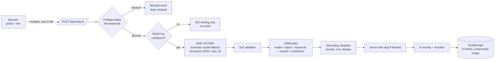

# ManualMate

ManualMate turns a photo of low-risk household furniture into a cautious inspection checklist. A vision model reads the actual uploaded image, returns a bounding box for the area to inspect first, and the server validates the model's safety classification before any repair step reaches the screen.

There is no demo fixture and no canned analysis. If the model is not configured or the call fails, the app says so and stops. It never substitutes invented results.

## Live deployment

- App: https://manualmate-production.vercel.app
- Health: https://manualmate-production.vercel.app/api/health
- Runtime: Vercel Node.js 22, `app/api/analyze` capped at 60 seconds. The adapter spends at most 55 seconds and falls back across models when Meta reports `UNAVAILABLE`.

## What is real

| Capability | Implementation |
| --- | --- |
| Vision analysis | The uploaded image is sent to Meta (`muse-spark-1.3` by default) with a structured JSON contract. If the primary is unavailable, the adapter tries ``, then ``. |
| Visual grounding | Meta returns `box_2d` regions normalized to 0-1000. The server validates bounds, size, and duplicates; the client draws them over the uploaded photo. |
| Safety gate | Six checks in `app/lib/safety.ts`. A blocked result is stripped of tools, parts, and steps on the server before the response leaves the API. |
| Repair checklist | The model returns ordered steps with a stop condition per step. The UI tracks progress and can copy a repair brief. |
| History | The last 8 results are stored in the browser as a compressed image plus thumbnail. No server database and no photo bucket. |
| Failure behavior | Missing key, invalid file, timeout, malformed model output, and provider refusal each produce a specific, retryable or terminal error. No fake success. |

## Requirements

- Node.js 22 LTS recommended (the deployment is pinned to `22.x`; newer local versions also work).
- A Google AI Studio API key with access to a vision model.

## Setup

```powershell
npm ci
Copy-Item .env.example .env.local
# set MODEL_API_KEY in .env.local
npm run dev
```

Open http://localhost:3000. The header must show `MODEL READY`. If it shows `SERVICE UNAVAILABLE`, the server cannot see a key and analysis is disabled by design.

Get a key from Google AI Studio: https://aistudio.google.com/apikey

## Verify

```powershell
npm run verify   # typecheck + 34 tests
npm run build
```

The test suite includes a full pipeline test against a local Meta-compatible HTTP server, so it runs without a real key.

To test the live path against a running server:

```powershell
npm run smoke -- http://localhost:3000 .\chair.jpg "wobbly chair leg"
```

## Architecture



Full details: [docs/ARCHITECTURE.md](docs/ARCHITECTURE.md).

## Request lifecycle

1. The browser downscales the photo to a maximum edge of 1280 px and sends JPEG via `FormData`.
2. The API checks the file signature, size, and rate limit.
3. A preflight scan checks the hint. `"electrical panel"` stops before any model call.
4. If no key is configured, the request fails with `503 missing_key`. There is no fixture or canned analysis.
5. Meta receives the image, a strict system prompt, and a JSON schema. `thinkingLevel` is `low`. A transient `UNAVAILABLE` response moves to the next configured model.
6. The response is parsed and validated with Zod; malformed JSON triggers one retry.
7. The safety gate checks the model's classification, object category, hazard keywords, dangerous actions, and confidence floor.
8. Grounding validation drops boxes that are out of bounds, too small, full-frame, or duplicated.
9. If blocked, the server removes tools, parts, and steps before responding.
10. The client draws validated boxes with percentage coordinates, so the marker stays aligned at any display size.

## Safety model

Blocked categories: electricity, gas, pressure/plumbing, structural, vehicles, medical, weapons, chemicals, and unclear subjects.

The gate is fail-closed:

- Preflight hint block before the model runs.
- The model must return a safety classification; `blocked` or any non-safe category stops.
- A hazardous object category stops even if the model claims safety.
- Hazard keywords in the observation are a backstop.
- Dangerous actions in the checklist stop the result.
- A self-rating below 30/100 becomes `unclear`.
- The server strips repair fields for every blocked result.

Hazard blocks name the professional to contact. Unclear results ask for a better photo instead of inventing guidance.

## Grounding honesty

Model boxes are approximate. ManualMate validates coordinates, minimum size, maximum area, and duplicates. Full-frame boxes are discarded. If no box survives, the UI says **No marker** and shows no box. The status is `Marker valid`, `Marker partial`, or `No marker`; it is not a claim of pixel-perfect detection.

## Privacy and data

- The photo is sent to Meta for one request. ManualMate does not persist it server-side.
- History lives in `localStorage`, capped at 8 entries, stored as a 640 px image plus a 180 px thumbnail.
- No accounts, no database, no analytics, no secret in client code.
- `GET /api/health` reports only whether a key is configured and which model is active.

## API

### `POST /api/analyze`

`multipart/form-data`:

| Field | Type | Required | Notes |
| --- | --- | --- | --- |
| `image` | file | yes | JPEG, PNG, or WebP. Max 8 MB. Signature checked. |
| `hint` | string | no | Max 300 chars. Can trigger the preflight block. |

Returns `{ result, meta }`. `result.blocked` is authoritative. Errors use HTTP status plus `{ error, code }`.

| Status | Code | Meaning |
| --- | --- | --- |
| 415 | `invalid_image` | Empty, oversized, unsupported, or mismatched file. |
| 429 | `rate_limited` | More than 10 analyses per minute per instance. |
| 502 | `auth` | The model rejected the credentials. |
| 502 | `invalid_output` | The model returned malformed or unvalidated JSON. |
| 503 | `missing_key` | The server has no model key. |
| 504 | `timeout` | The model did not answer in time. |

### `GET /api/health`

```json
{ "ok": true, "configured": true, "provider": "meta", "model": "muse-spark-1.3", "version": "1.0.0" }
```

`ok` and `configured` are false when the key is missing. The endpoint never returns the key.

## Environment

```dotenv
MODEL_API_KEY=
MODEL_NAME=muse-spark-1.3
MODEL_FALLBACK_MODELS=,
```

`GOOGLE_API_KEY` is accepted as an alias. `MODEL_FALLBACK_MODELS` is a comma-separated cascade. `MODEL_BASE_URL` is an optional override for tests or a compatible gateway.

## Deploy

```powershell
npm i -g vercel
vercel --prod
```

Set `MODEL_API_KEY` in the Vercel project environment. `/api/analyze` is a Node serverless function with `maxDuration = 60`.

For a production deployment, add authentication, a shared rate limiter, and persistent storage if you need history across devices. The current build is a single-user, local-history product.

## Repository map

```text
app/
  api/analyze/route.ts     multipart handling, rate limit, error mapping
  api/health/route.ts      safe configuration status
  components/              upload, overlay, result, history, safety views
  lib/analysis.ts          orchestration + server-side safety strip
  lib/meta.ts            real model adapter, retry, timeout
  lib/model-schema.ts      Zod contract, Meta schema, prompts
  lib/safety.ts            six-check safety gate
  lib/grounding.ts         box validation and honesty status
  lib/upload.ts            signature and size validation
  types.ts                 shared contract
tests/                     34 tests, including a mock Meta server
docs/
  ARCHITECTURE.md
  EVIDENCE.md
```

## Known limitations

- Bounding boxes are model estimates, not a segmentation mask. Confirm visually.
- HEIC photos from some phones are rejected; use JPG/PNG/WebP.
- Rate limiting is per server instance and in-memory, not global.
- There is no authentication; history is device-local.
- The model can still miss a defect. The app is a visual observation tool, not a diagnosis.
- Blocked categories are intentionally broad. Overblocking is preferred to unsafe guidance.

## Verification map

Start with [docs/EVIDENCE.md](docs/EVIDENCE.md). Short version: the live path is `app/api/analyze/route.ts` -> `app/lib/analysis.ts` -> `app/lib/meta.ts`, and `tests/meta-integration.test.ts` runs that entire path against a Meta-compatible server.
