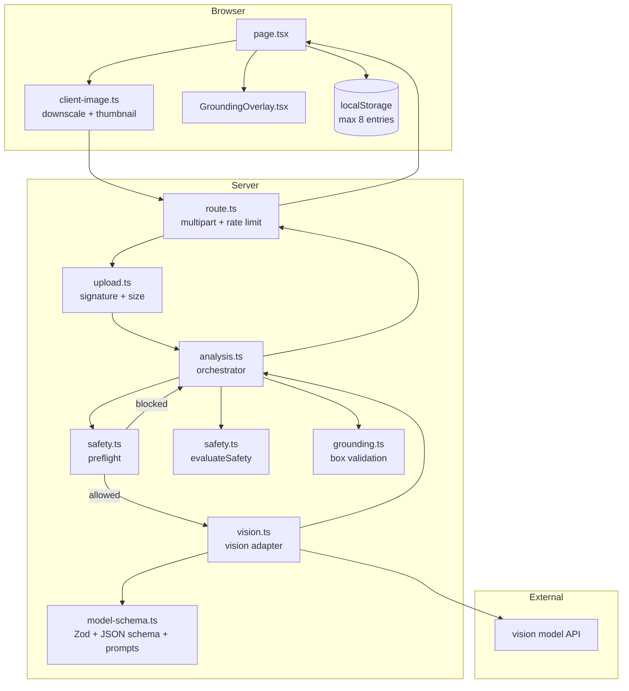
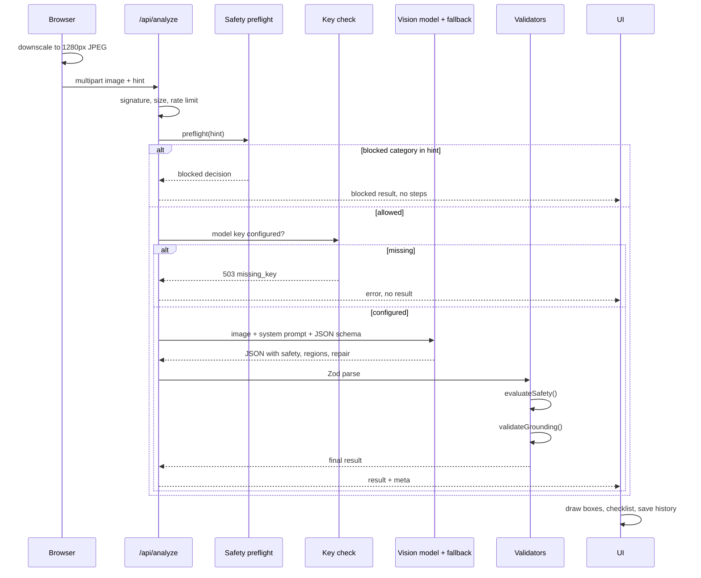
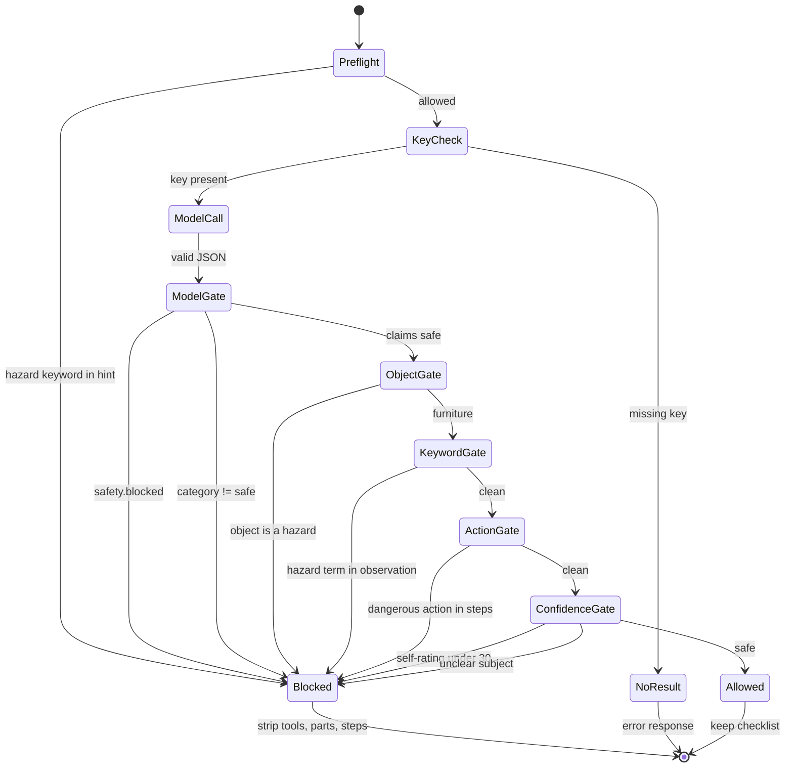

# ManualMate Architecture

## Context

ManualMate is a single-purpose visual inspection product:

1. Read the photo the user actually uploaded with a vision model.
2. Return a bounding box for the area to inspect first, validated against the image.
3. Stop before guidance when a category is hazardous or unclear.
4. Produce a cautious, ordered checklist that can be copied and acted on.

There is no demo fixture and no canned analysis. The model is a required dependency. If it is missing or fails, the product says so and returns no repair steps.

The system is one Next.js app, one model call, no database, and no auth. Complexity is concentrated in the safety gate and the grounding validator.

## Components



### Why the model call is server-side

- The API key never reaches the browser.
- Input validation and the safety strip cannot be bypassed by a client.
- The response contract is validated before the UI sees it.
- The provider can be swapped without changing the UI.

## Request sequence



## Safety state machine



`result.safety.source` records which check fired: `preflight`, `model`, `keyword`, `confidence`, or `none`. `result.safety.nextStep` distinguishes a professional referral (`professional`) from a request to retake the photo (`retake`).

## Grounding pipeline

Input: the model's `regions[]`, each with `box_2d` in `[ymin, xmin, ymax, xmax]`, normalized to 0-1000.

`app/lib/grounding.ts` performs:

1. Cap at four regions.
2. Reject non-arrays, wrong lengths, and non-finite numbers.
3. Clamp coordinates to 0-1000.
4. Reject boxes with a span below 10 units on either axis.
5. Reject boxes covering more than 92% of the image. A full-frame box is not a marker.
6. Deduplicate identical boxes.
7. Mark boxes covering more than 55% as broad.
8. Return `verified`, `partial`, or `ungrounded` with a human-readable note.

The UI maps coordinates to CSS percentages:

```ts
top:    `${ymin / 10}%`
left:   `${xmin / 10}%`
width:  `${(xmax - xmin) / 10}%`
height: `${(ymax - ymin) / 10}%`
```

The image renders at `width: 100%; height: auto`, so there is no letterboxing and the boxes cannot drift.

### Grounding honesty

`verified` means the coordinates are valid and inside the photo. It does not mean the model is semantically correct. The UI reads **Marker valid** and asks the user to confirm the area visually. If no box survives, the app shows **No marker** and no box.

## Model contract

The raw model output is validated by `rawAnalysisSchema` in `app/lib/model-schema.ts`:

```ts
{
  object: { label, category },
  safety: { blocked, category, reason, professional },
  observation,
  confidence,          // 0-100 self-rating, not a probability
  regions: [{ label, box_2d: [4 numbers], severity }],
  repair: {
    difficulty, estimatedTime, tools, parts,
    steps: [{ title, detail, safety }],
    note
  }
}
```

The model request also uses a JSON Schema (`analysisResponseSchema`) with enums and required fields. Structured output reduces parse failures; Zod is still the final authority.

Prompt priorities are explicit: safety first, grounding second, repair third. The model is told to return an empty `regions` array rather than invent a marker, and to use a low self-rating when the evidence is weak.

## Provider swap

The provider boundary is a single function:

```ts
analyzeWithModel(input): Promise<{ raw, model, latencyMs }>  // primary + fallback cascade
```

To add a different vision provider:

1. Create an adapter that returns raw JSON satisfying `rawAnalysisSchema`.
2. Throw `ProviderError` with the same codes for auth, rate limits, timeouts, refusals, and invalid output.
3. Switch the call in `app/lib/analysis.ts`.

No UI, safety, grounding, or storage code changes.

## Failure handling

| Failure | Behavior | Code |
| --- | --- | --- |
| No API key | Terminal error, no analysis | 503 `missing_key` |
| Invalid file signature | Reject before model call | 415 `invalid_image` |
| Oversized file | Reject before model call | 415 `invalid_image` |
| Rate limit | Reject for one minute | 429 `rate_limited` |
| Model timeout | One retry, then fail | 504 `timeout` |
| Model returns 429/5xx | One retry after 700 ms | `rate_limited` / `upstream` |
| Invalid or missing key | No retry, credentials message | 502 `auth` |
| Malformed JSON | One retry, then fail | 502 `invalid_output` |
| Provider refuses image | No repair guidance | 422 `model_refusal` |
| Unexpected error | Generic message, no internals | 500 `internal` |

The upstream error body is never forwarded to the client. Only a coarse code and a safe message are returned. Logs contain the error code, never the image, prompt, or key.

## Privacy

- The image exists in server memory for one request.
- No server-side storage, no database, no object storage.
- History is browser-local: a 640 px JPEG and a 180 px thumbnail per entry, capped at 8.
- Clearing history removes the localStorage key.
- `localStorage` failures degrade to an empty history without breaking the result view.

## Deployment

- Vercel free tier, Node runtime for `/api/analyze`.
- `maxDuration = 60` seconds.
- No edge runtime because the app uses Node `Buffer` and `crypto.randomUUID`.
- Security headers are set in `next.config.mjs`.
- Rate limiting is in-memory per instance. For multi-instance production, replace it with Upstash Redis or Vercel KV.

## Test strategy

`npm run verify` runs typecheck and 34 tests:

- `tests/safety.test.ts` — preflight, model block, hazard object, keyword backstop, dangerous action, confidence floor, next-step routing.
- `tests/grounding.test.ts` — valid, clamped, full-frame, tiny, broad, duplicates, invalid data.
- `tests/upload.test.ts` — magic bytes, size limit, mismatched declared type.
- `tests/analysis.test.ts` — server-side stripping, missing-key refusal, preflight short-circuit.
- `tests/vision-integration.test.ts` — full pipeline against a local model-compatible HTTP server: request shape, base64 image, JSON schema mode, malformed-JSON retry, invalid-key mapping.

## Non-goals

- No accounts, multi-tenancy, or permanent image storage.
- No diagnosis or structural calculation.
- No repairs for hazardous categories.
- No guarantee that a model box is semantically correct; human confirmation is required.
- No fixture fallback when the model is unavailable; the only fallback is the configured live model cascade.
